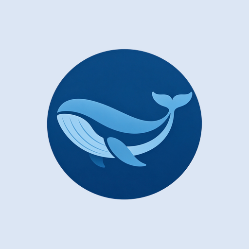
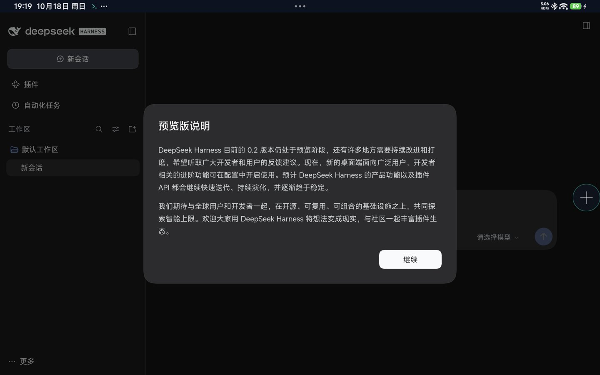
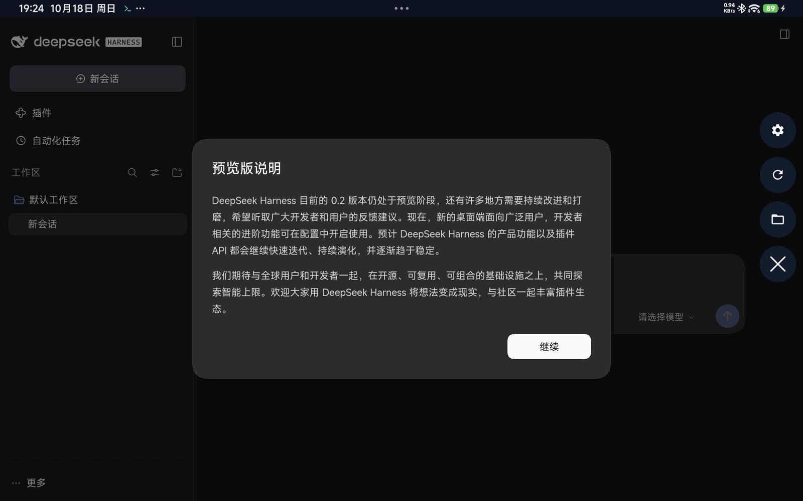
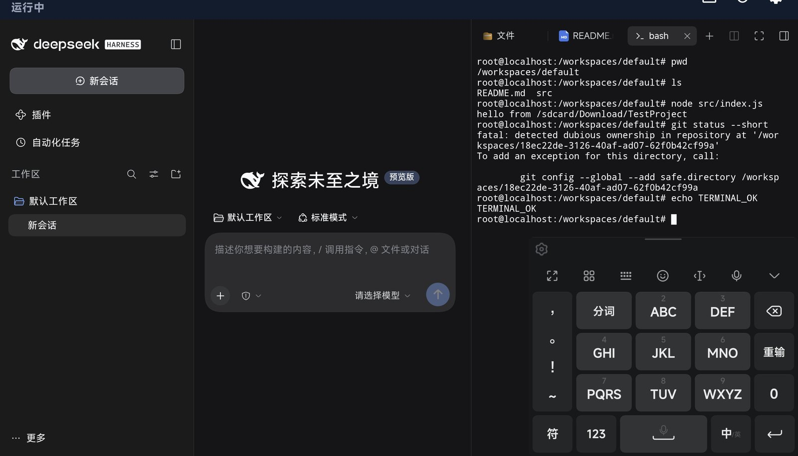
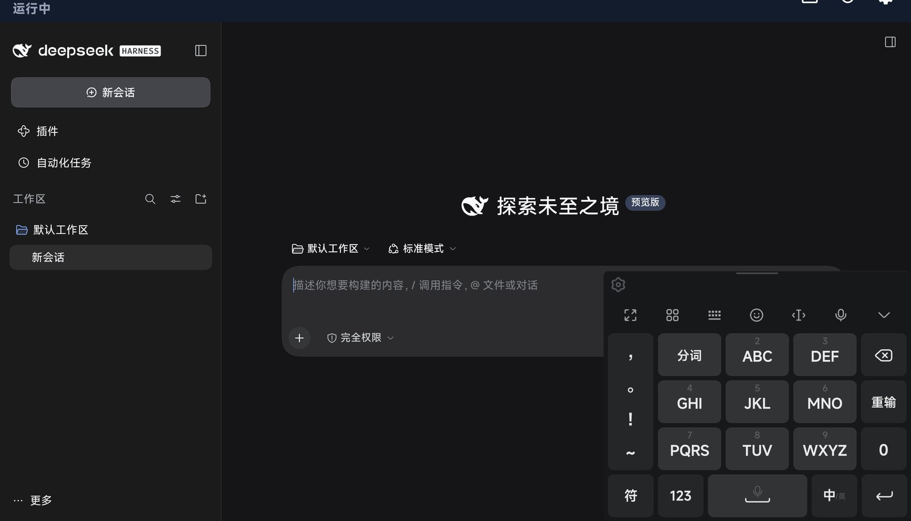
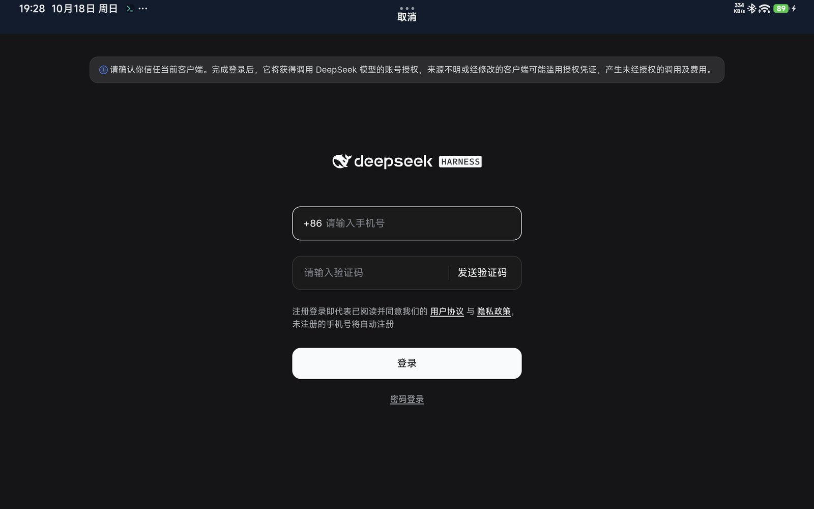

<div align="center">



# Harness Android

Run the full official **DeepSeek Harness** Web UI and agent engine on Android tablets and phones.

Complete official UI · Local-folder workspace · Real PTY terminal · Upstream auto-sync · Sideload updates

[简体中文](README.md) · [English](README.en.md)

[](https://github.com/Luqijian/DeepSeek_Harness_Android/actions/workflows/build.yml)
[](https://github.com/Luqijian/DeepSeek_Harness_Android/releases)
[](LICENSE)
[](https://www.npmjs.com/package/@deepseek-ai/dsh)
[](https://developer.android.com)

</div>

> **Unofficial project.** Harness Android is an independent community effort, not affiliated with DeepSeek. This is a **Developer Edition**: sideloaded, with direct shared-storage access. Only open projects you trust.

## What it is

Harness Android does not rewrite DeepSeek Harness, and it is not a remote web wrapper. It installs the **official npm package `@deepseek-ai/dsh` unchanged** into a bundled Debian 13 arm64 userland, runs it under [proot](https://github.com/termux/proot) inside the Android app sandbox, and lets the Android layer do only three things:

1. Extract and supervise the Linux runtime.
2. Load the official Web UI in a WebView (`127.0.0.1` + launch token).
3. Bind a shared-storage folder you pick as the Linux session workspace.

The official UI, sessions, file panel, terminal, plugins, and automation all come from upstream; this project provides the runtime, native integration, and update channel.

## Highlights

- **Complete official Web UI** — sessions, workspaces, file tree/preview/edit, terminal, plugins, scheduled tasks, model settings.
- **Open any local folder as a workspace** — pick a directory under `/storage/emulated/0`; proot binds it to `/workspaces/default`, so AI edits land in the original folder live. No copy, no sync.
- **Real terminal** — Node-pty runs inside Debian; `bash`, `git`, `rg`, `node`, `npm`/`pnpm` work. Android ownership/`core.fileMode` quirks are handled.
- **Works offline** — Debian rootfs, Node 24, official dsh, and common tooling are bundled. First launch extracts ~1.2 GB; no runtime downloads afterwards.
- **Follows upstream automatically** — a daily CI job watches npm `latest`, bumps `dshVersion`, and opens a PR. **Every successful main build publishes a signed GitHub Release automatically**; the in-app updater reads `update.json` from the latest release.
- **Toolbar-free floating ball** — a plus ball expands to workspace/reload/settings; drag it anywhere or dock it as a translucent half-sphere at a screen edge.
- **Background operation** — a `specialUse` foreground service plus WakeLock keeps the engine alive with the screen off; the notification can stop or restart it.
- **Account login works** — the official login flow uses `window.open()`; multi-window plus a child WebView makes the phone/verification-code login page render correctly.

## Screenshots

| Official UI | Floating menu |
| --- | --- |
|  |  |

| Real terminal | Workspace file panel |
| --- | --- |
|  |  |

| DeepSeek account login |
| --- |
|  |

## Quick start

**Requirements:** Android 8.0 (API 26)+, arm64 device, WebView 111+, at least 2.5 GB free space.

1. Download the latest `harness-android-*.apk` from [Releases](https://github.com/Luqijian/DeepSeek_Harness_Android/releases/latest).
2. Allow "install unknown apps" for your browser/file manager, then install the APK.
3. On first launch, read the safety notice, grant notifications and "All files access".
4. Wait for runtime extraction (~30–60 s, with percentage), then the official UI loads.
5. Configure a model API key under **Settings → Models**, or use **Log in** for a DeepSeek account.

adb alternative:

```bash
adb install -r harness-android.apk
adb shell pm grant io.github.luqijian.harnessandroid.debug android.permission.POST_NOTIFICATIONS
adb shell appops set --uid io.github.luqijian.harnessandroid.debug MANAGE_EXTERNAL_STORAGE allow
```

## Usage

- **Switch workspace**: floating ball → folder icon → choose `/storage/emulated/0/...`; the engine restarts and binds it. The active workspace is persisted and shown in Settings.
- **Terminal**: official UI right sidebar → "New terminal"; commands run in the session workspace.
- **Models/account**: official UI → Settings → Models for an API key, or **Log in** for DeepSeek account authorization.
- **Updates**: Settings → Check for updates; the APK is downloaded, SHA-256 verified, then the system installer opens.
- **Floating ball**: tap to expand (plus becomes X); drag freely; release near a side edge to dock as a translucent half-sphere; tap to undock.
- **Engine control**: start/stop/restart in Settings or from the notification; share logs from Settings.

## Architecture

```text
┌─────────────────────────────────────────────────────────────┐
│ Android app (Kotlin, WebView, specialUse FGS)                │
│  MainActivity / FloatingMenuView / SettingsActivity          │
└───────────────┬─────────────────────────────────────────────┘
                │ http://127.0.0.1:3080/?token=…
┌───────────────▼─────────────────────────────────────────────┐
│ Bundled runtime (assets, extracted on first launch)          │
│  Debian 13 arm64 → Node 24 → @deepseek-ai/dsh (official)     │
│  proot (Termux, 16 KB aligned) with bind mounts:             │
│    /root/.dsh         ← app files/dsh-home                   │
│    /workspaces/default ← /storage/emulated/0/<project>       │
│    /tmp, /etc/resolv.conf, /root/documents                    │
└─────────────────────────────────────────────────────────────┘
```

- No engine source patches. Adaptations are a managed block in `$DSH_HOME/profiles/web/cordis.patch.yml` (`fs-sandbox.cwd`, `sandbox-policy`, `permission.defaultPreset`) plus launch environment variables.
- proot host binaries live in `jniLibs/arm64-v8a/lib*.so` and are extracted to nativeLibraryDir (`useLegacyPackaging`). CI asserts every ELF has `p_align ≥ 16 KB`.
- Sessions, config, and workspaces are mounted separately; APK upgrades keep `dsh-home`. Uninstalling deletes all app-local data.

## Verified

| Device | OS | Result |
| --- | --- | --- |
| Xiaomi Pad 6 Pro | Android 15 (API 35) | Official UI, file panel, README preview, terminal, account login page, floating ball all pass |
| GitHub Actions `ubuntu-24.04-arm` | Debian 13 arm64 | Runtime build, 16 KB ELF check, APK build pass |

Tested versions: `@deepseek-ai/dsh 0.2.1-rc.2`, Node `24.22.0`, WebView `155.0.8059.43`.

## Docs

| Document | Contents |
| --- | --- |
| [docs/BUILD.md](docs/BUILD.md) | Runtime build, APK build, signing, CI release flow |
| [docs/ARCHITECTURE.md](docs/ARCHITECTURE.md) | Boot chain, proot mounts, config layer, lifecycle, security boundary |
| [docs/USAGE.md](docs/USAGE.md) | Install, permissions, workspace, terminal, account/API key, updates, data locations |
| [docs/TESTING.md](docs/TESTING.md) | adb automation hooks, tablet acceptance checklist, CI checks |
| [docs/TROUBLESHOOTING.md](docs/TROUBLESHOOTING.md) | Black screen, background freezing, git ownership, ports, disk space |
| [docs/PRIVACY.md](docs/PRIVACY.md) | Local-first data and privacy notes |
| [THIRD_PARTY_NOTICES.md](THIRD_PARTY_NOTICES.md) | Debian, Node, proot, dsh and other licenses |

## Compatibility and limits

- **Platform:** arm64 Android 8.0+ (targetSdk 36); APK ~349 MB (runtime included), ~1.2 GB after first extraction.
- **proot overhead:** syscall-heavy work is ~40% slower; Node cold start is ~10 s.
- **`/sdcard` semantics:** shared storage is FUSE, so chmod, symlinks, and hardlinks do not work; some git/npm operations are limited. For full POSIX, copy the project into `/root` inside the terminal (it will not sync back).
- **Sandbox:** Landlock/bwrap are unavailable on Android, so `danger-full-access` is used. proot is not a security boundary; the Android app sandbox is.
- **Desktop-only features:** Electron tray, desktop auto-update, and macOS Computer Use do not apply. The web sidebar browser and the official web features remain available.
- **Not on Google Play:** the Developer Edition uses All-files access and GitHub self-updates; it is distributed only via Releases.

## Security

- The engine listens on `127.0.0.1` only and requires a launch token plus a signed cookie; LAN is off by default.
- No telemetry or analytics SDK. API keys stay in the local `$DSH_HOME/.credentials.yaml`.
- AI can run commands and read/write your authorized workspace. Only open trusted projects, set usage limits on API keys, and back up important files.
- Report security issues privately via [SECURITY.md](SECURITY.md); please do not publish exploit details.

## Development

```bash
# 1) Build the runtime (Linux / arm64 runner)
bash runtime/build-runtime.sh
cp runtime/out/rootfs.tar.gz app/src/main/assets/runtime/rootfs.bin
cp runtime/out/manifest.json app/src/main/assets/runtime/manifest.json
cp runtime/out/jniLibs/arm64-v8a/*.so app/src/main/jniLibs/arm64-v8a/

# 2) Build the APK (JDK 17 + Android SDK 36)
./gradlew :app:assembleDebug
```

- `dshVersion` lives in `gradle.properties`; the `upstream-sync` workflow checks npm daily and opens a PR.
- Prefer the config layer (`cordis.patch.yml` managed block) and environment variables over source patches. If a patch is unavoidable, update `docs/ARCHITECTURE.md` and explain it in the PR.
- Never commit runtime blobs, keystores, `local.properties`, or tokens. See [CONTRIBUTING.md](CONTRIBUTING.md).

## License

MIT © 2026 Luqijian. Bundled Debian, Node.js, proot, `@deepseek-ai/dsh`, and other components keep their own licenses; see [THIRD_PARTY_NOTICES.md](THIRD_PARTY_NOTICES.md).
